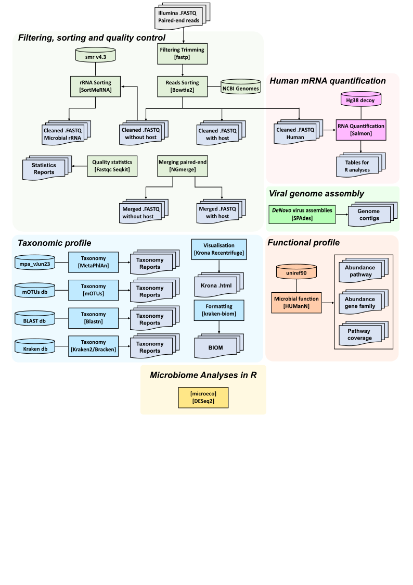

# Metatranscriptomics Illumina data

Pipeline for Metatranscriptomics (MTX) analyses from Illumina sequencing data (e.g. MiSeq): host and rRNA filtering, taxonomic profiles, bacterial functional profile, host coding-gene quantification and viral metagenome assembly. It runs on the CRIANN HPC cluster (SLURM) and is driven by a single configuration script.

| Script | Version | Role |
|---|---|---|
| `Config_Pipeline_Metatranscriptomics_Illumina_Template.sh` | v1.10 | Settings, input renaming, job submission |
| `P01_MTX_Illumina_Analyses_Template.sh` | v2.10 | Per-sample analyses (SLURM array job) |
| `P02_MTX_Illumina_Outputs-forR_Template.sh` | v1.11 | Merge of all samples, tables and reports for R |

**TO ADD**
- Sourmash (taxonomic profile)
- Alternative to HUMAnN3 for microbial functional analyses

## Contents
1. [Quick start](#quick-start)
2. [Input files](#input-files)
3. [Directory structure](#directory-structure)
4. [Options](#options)
5. [Pipeline workflow](#pipeline-workflow)
6. [Outputs](#outputs)
7. [Requirements](#requirements)
8. [Methodological notes](#methodological-notes)
9. [Changelog](#changelog)
10. [Author](#author)

## Quick start

1. Put the three scripts in `GROUP/PROJECT/Scripts/` (see [Directory structure](#directory-structure)).
2. Create `List_samples_RUN.txt` (and optionally `RUN_metadata.tsv`) in the same folder.
3. Edit `EMAIL=""` in the Config script (used for the SLURM `--mail-user` line).
4. Run the Config script from `Scripts/`, changing only the options you need:

```bash
# Whole pipeline (P01 then P02) on 96 samples, MetaPhlAn and mOTUs added
bash Config_Pipeline_Metatranscriptomics_Illumina_Template.sh -p PROJECT -r RUN -ar 1-96 -me yes -mo yes -pi all

# Only the per-sample analyses (default), a subset of samples
bash Config_Pipeline_Metatranscriptomics_Illumina_Template.sh -p PROJECT -r RUN -ar 1,12,35-40

# Only the combined outputs for R (after P01 has finished)
bash Config_Pipeline_Metatranscriptomics_Illumina_Template.sh -p PROJECT -r RUN -ar 1-96 -pi step_2
```

> **Check on 2-3 samples first.** Test the options you plan to use (HUMAnN, SPAdes, BLASTN...) before launching a full plate.

## Input files

### `List_samples_RUN.txt`
A `.txt` file with one sample name per line. A name must start with `[a-zA-Z]`, contain **no space** and **no underscore** (the pipeline identifies the sample as everything before the first underscore in file names):
```
S23-MTX-COV-NOSE
S59-MTX-HRV-LUNG
```
The number of lines is the value to give to `-ar` (e.g. `1-96`).

### `RUN_metadata.tsv` (optional)
Sample metadata for R, named after the run. P02 looks for `Scripts/RUN_metadata.tsv` and copies it to `Microbiome_R/RUN/Metadata/`. Without it, the BIOM files with metadata are skipped (the other BIOM files are still produced). Sample identifiers must match the names in `List_samples_RUN.txt`.

### Fastq files
With `-s yes` (MiSeq, default), the Config script renames the raw files (`Sample1_Sxx_L001_R1_001.fastq.gz` becomes `Sample1_R1.fastq.gz`) before submission. The renaming is skipped when the files are already renamed.

## Directory structure
The beginning directory structure with Illumina MiSeq data should be:
```
 .
 └── GROUP/
     └── PROJECT/
         ├── Output_Illumina/
         │   └── RUN/
         │       └── Alignment_1/
         │           └── something/
         │               └── Fastq/
         │                   ├── Sample1_Sxx_L001_R1_001.fastq.gz
         │                   ├── Sample1_Sxx_L001_R2_001.fastq.gz
         │                   ├── Sample2_Sxx_L001_R1_001.fastq.gz
         │                   └── Sample2_Sxx_L001_R2_001.fastq.gz
         └── Scripts/
             ├── Config_Pipeline_Metatranscriptomics_Illumina_Template.sh
             ├── P01_MTX_Illumina_Analyses_Template.sh
             ├── P02_MTX_Illumina_Outputs-forR_Template.sh
             ├── RUN_metadata.tsv
             └── List_samples_RUN.txt

*/ denotes directories
```

## Options
Usage: `bash Config_Pipeline_Metatranscriptomics_Illumina_Template.sh -p PROJECT -r RUN -ar ARRAY [other options]`

`-p`, `-r` and `-ar` are required. All other options have a default value. Options taking yes/no are validated by the script.

### Dataset and samples
| Option | Description | Default |
|---|---|---|
| `-g`, `--group` | Group folder name | `ViroCaen` |
| `-p`, `--project` | Project folder name (e.g. NEOBIOME) | required |
| `-r`, `--run` | Folder with the input reads (e.g. 20250404_Neobiome_96samples) | required |
| `-ar`, `--array` | Samples to analyse: `1-96`, or a subset like `1,12,35-40` | required |
| `-s`, `--seq` | Raw fastq generated by Illumina MiSeq (`yes`/`no`) | `yes` |

### Cleaning
| Option | Description | Default |
|---|---|---|
| `-qs`, `--qscore` | Minimum Phred score for Illumina reads (fastp) | `30` |
| `-ho`, `--host` | Host genome for mapping and filtering: `Hsapiens`, `Ppipistrellus`, `Mmyotis`, `Rhipposideros`, `Efuscus`, `Rferrumequinum` | `Hsapiens` |

### Taxonomic profile
| Option | Description | Default |
|---|---|---|
| `-kr`, `--kraken` | Run Kraken2/Bracken (`yes`/`no`) | `yes` |
| `-dbk`, `--databaseKraken` | Kraken2/Bracken database: `PlusPFP-2026`, `PlusPFP-2025`, `Standard`, `customDB-2023`, `core-nt-Database`, `nt-Database`, `EuPathDB46`, `RefSeqV205-Complete`, `RefSeqV205-Complete-500GB`, `ChocoPhlan3` | `PlusPFP-2026` |
| `-dbS`, `--databaseAmplicon` | Kraken2/Bracken database for rRNA reads: `16SEMU`, `Greengenes`, `SILVA`, `RDP`, `ITS` | `16SEMU` |
| `-c`, `--confidence` | Kraken2 confidence score ([0,1]) | `0` |
| `-tk`, `--thresholdKraken` | Minimum number of hit groups | `2` |
| `-tb`, `--thresholdBracken` | Reads required before abundance re-estimation with Bracken | `10` |
| `-kb`, `--kmerslength` | Bracken read length: `50`, `75`, `100`, `150`, `200`, `250`, `300` | `100` |
| `-b`, `--blastn` | Taxonomic profile with BLASTN (`yes`/`no`), can be very long | `no` |
| `-dbb`, `--databaseBlastn` | BLAST database: `nt`, `Betacoronavirus`, `nr`, `nt_viruses`, `ref_viruses_rep_genomes`, `ref_viroids_rep_genomes`, `16S_ribosomal_RNA`, `18S_fungal_sequences`, `28S_fungal_sequences`, `ITS_RefSeq_Fungi` | `nt` |
| `-e`, `--evalue` | E-value for saving BLAST hits | `1e-5` |
| `-me`, `--metaphlan` | Taxonomic profile with MetaPhlAn 4 (`yes`/`no`) | `no` |
| `-mo`, `--motus` | Taxonomic profile with mOTUs (`yes`/`no`) | `no` |
| `-cu`, `--cutoff` | mOTUs: minimum number of marker genes (1 = higher recall, higher = higher precision) | `3` |

Check that the Bracken k-mer distribution file matching `-kb` exists in the chosen database. The Config script comments list the size and content of every database.

### Additional analyses
| Option | Description | Default |
|---|---|---|
| `-hu`, `--humann` | Bacterial functional profile with HUMAnN 3 (`yes`/`no`) | `yes` |
| `-sp`, `--spades` | Metaviral genome assembly with SPAdes (`yes`/`no`) | `no` |
| `-sa`, `--salmon` | Host transcriptome read counts with Salmon (`yes`/`no`) | `no` |

The HUMAnN run based on the Bracken profile needs `-kr yes`; with `-kr no` it is skipped (the Config script prints a warning).

### Part of the pipeline to submit
| Option | Description | Default |
|---|---|---|
| `-pi`, `--pipeline` | `step_1` (per-sample analyses), `step_2` (combined outputs for R) or `all` (both) | `step_1` |
| `-h`, `--help` | Show the help message | |

With `-pi all`, P02 is submitted with a SLURM `afterany` dependency: it starts when all P01 tasks have ended, **even if some failed**. Check the P01 logs before using the tables, or switch to `afterok` in the Config script to require that all tasks succeeded.

## Pipeline workflow



### P01: per-sample analyses (one SLURM array task per sample)
1. Read cleaning with fastp (quality, adapters), then FastQC and seqkit statistics.
2. Host filtering: Bowtie2 mapping on the host genome, giving *With-host* and *Without-host* read sets (BAM and mapping statistics kept).
3. Paired-end merging with NGmerge.
4. Microbial rRNA removal with SortMeRNA, giving a *Without-microbialrRNA* read set.
5. Taxonomic profiles: Kraken2/Bracken (always, if `-kr yes`) on the three read sets, rRNA reads on the 16S/ITS database, Krona plots, extraction of reads by taxonomic group (archaea, bacteria, fungi, viruses, eukaryota, microbiome, host, no-hit), and optionally BLASTN, MetaPhlAn 4 and mOTUs.
6. Optional: HUMAnN 3 on the host- and rRNA-depleted merged reads (MetaPhlAn profile and Bracken profile), Salmon quantification of host genes, metaviral SPAdes assembly.
7. Results are moved to the project folders and the local working directory is cleaned.

### P02: combined outputs for R
1. Bracken reports gathered and converted to MPA tables.
2. BIOM files (Species and Genus) for each read set (*With-host*, *Without-host*, *Without-host and microbial rRNA*).
3. Combined Bracken OTU table.
4. Recentrifuge reports, MultiQC reports (FastQC, fastp, Kraken2).
5. MetaPhlAn merged tables and heatmap (`-me yes`).
6. HUMAnN merged tables (gene families, pathway abundance, pathway coverage), CPM normalization of gene families and pathway abundance, stratified and unstratified tables (`-hu yes`).

## Outputs
Main folders created in `GROUP/PROJECT/` (`RUN` is your run name):
```
 .
 ├── RawReads_Illumina/RUN
 ├── CleanedReads_Illumina/RUN/
 │   ├── Cleaned_WithHost_Reads/ (+ Merged)
 │   ├── Cleaned_NoHost_Reads/ (+ Merged)
 │   ├── Cleaned_NoHost_NomicrobialrRNA_Reads
 │   ├── Cleaned_OnlyHost_Reads
 │   ├── Cleaned_microbialrRNA_Reads
 │   └── BAM
 ├── QC_Stats/RUN/                  FastQC, fastp, seqkit, mapping statistics
 ├── sortmerna/RUN
 ├── TaxonomicProfile/RUN/          Kraken2/Bracken reports and Krona, BLAST_db-xxx, MetaPhlAn, mOTUs
 ├── FunctionalMicrobiome/RUN/      Humann3_MetaPhlAn and Humann3_Bracken
 │   └── .../Join_Tables            merged HUMAnN tables
 ├── FunctionalHumanHost/RUN        Salmon counts for DESeq2
 ├── DeNovoVirus/RUN                metaviral SPAdes contigs and graphs
 ├── Microbiome_R/RUN/              files to load in R
 │   ├── BIOM
 │   ├── Combined
 │   ├── HumannPathways
 │   ├── OTU_Table
 │   └── Metadata
 ├── Log/RUN_runDATE                settings and logs of each run
 └── Scripts/Sbatch_log
```

### BIOM file names (P02)
One set of files is produced for each read set; the set is part of the file name so that nothing is overwritten:
```
All_BrackenSpecies_With-HOST_BIOM-json.biom
All_BrackenSpecies_Without-HOST_BIOM-tsv.tsv
All_BrackenGenus_Without-HOST_Without-microbialrRNA_withMetadata_BIOM-HDF5.biom
All_Bracken<Species|Genus>_<set>_TaxID-OTUs_forPhyloT.txt
```
`HOST` is the host given with `-ho`. The `withMetadata` file is only produced when a metadata file is found.

### HUMAnN tables (P02)
In `FunctionalMicrobiome/RUN/Humann3_<MetaPhlAn|Bracken>/Join_Tables/`: `RUN_AllSamples_genefamilies.tsv`, `..._pathabundance.tsv` and `..._pathcoverage.tsv`, plus `..._genefamilies_norm-cpm.tsv` and `..._pathabundance_norm-cpm.tsv`, and the stratified and unstratified versions of the pathway tables. `pathcoverage` is not renormalized to CPM.

## Requirements
- CRIANN cluster account, SLURM, `module load py_env/miniconda3/25.7.0`.
- Conda environment `MTX_env` containing the tools used by the scripts: fastp, Bowtie2, samtools, SortMeRNA, FastQC, seqkit, Kraken2, Bracken, KrakenTools, Krona, Recentrifuge, kraken-biom, MetaPhlAn 4, mOTUs, HUMAnN 3.9, hclust2, BLAST+, Salmon, SPAdes. NGmerge is called from `/soft/2019013/Logiciels/`. Exact versions are listed in the header comments of P01 and P02.
- Databases in `/dlocal/home/2019013/Databases/` (Bowtie2 host indexes, Kraken2/Bracken, SortMeRNA, MetaPhlAn, mOTUs, HUMAnN, BLAST).
- Default resources: P01 asks 1 node, 96 CPUs, 500 GB and 4 days per sample (partition `long`); P02 asks 25 GB and 5 hours (partition `2tcourt`).

The paths are specific to the CRIANN account `2019013`; adapt them in the scripts to use the pipeline elsewhere.

## Methodological notes
Choices that affect results and are worth knowing when interpreting them:
- Host reads are removed by Bowtie2 mapping on a genomic index; reads that span exon junctions may not map. The `OnlyHsapiens` read counts and the Kraken2 extraction of metazoan reads give an idea of the remaining host reads.
- Kraken2 confidence is `0` by default; the Config script suggests higher values for Illumina data. Adjust `-c` to your question.
- HUMAnN is run on the merged reads depleted of host and microbial rRNA, and its Bracken-based taxonomic profile comes from the same read set.
- Merged reads have variable length whereas Bracken uses a single read length (`-kb`).

## Changelog
| Version | Changes |
|---|---|
| Config v1.10 | Fix undefined `$FOLDER` in the renaming step; `KRAKEN` and yes/no values validated; `-h` exits with code 0; correct Kraken2 threshold in messages |
| P01 v2.10 | fastp without `--dedup`; HUMAnN run on host- and rRNA-depleted merged reads, with the Bracken profile taken from the same read set |
| P01 v2.9 | Bracken on the 16S database fixed; Salmon redirection fixed; `LOCAL_WORK_DIR` and sample guards; file moves no longer abort the job before cleanup; HUMAnN (Bracken profile) skipped without bacterial profile; MetaPhlAn `--index`; BLAST best-hit selection; portable FastQC renaming; `flagstat` on all reads |
| P02 v1.11 | MultiQC runs in `MTX_env`; `multiqc_env` removed; metadata file is `RUN_metadata.tsv` only |
| P02 v1.10 | `${RUN}_` variable fix; HUMAnN and MetaPhlAn paths aligned with P01; one BIOM set per read set; metadata lookup fixed; log folder created; no CPM on `pathcoverage`; CPM normalization of gene families added |

## Author
Nicolas Nesi, UMR 1311 Inserm DYNAMICURE, Université de Caen Normandie
